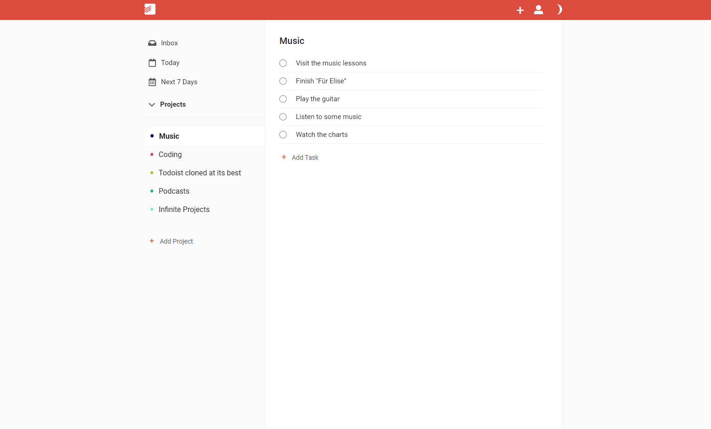

# Todoist Clone

My first Web-App. Followed a tutorial and later extended with some custom features.

Cloned Todoist's basic functionality and UI. Also added some custom tweaks.

Built using React, Custom hooks, React's Context API, Sass and Firebase.
[Try it out for yourself!](https://floriankulig.github.io/Todoist-Clone/)

## Preview

## Functionality

You are able to create an account for yourself, add projects and create tasks for these.
